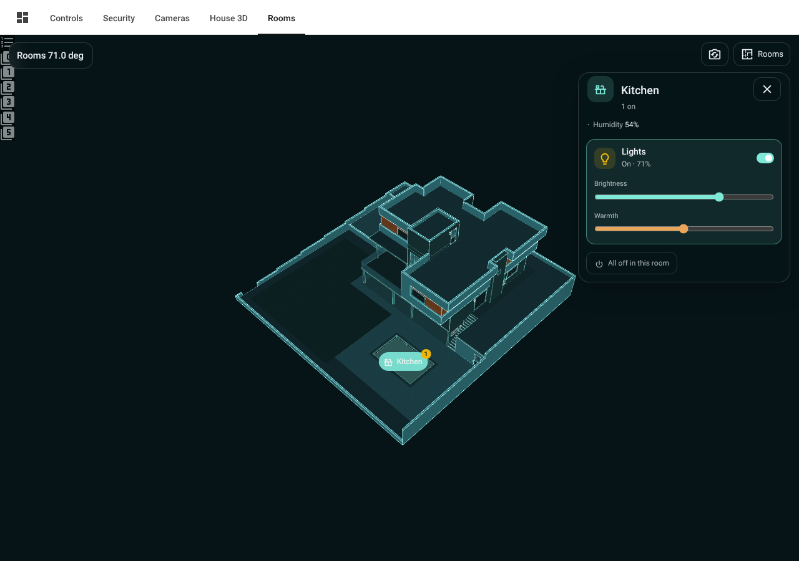

<div align="center">
  
  <h1>Public Access</h1>
  <p><strong>Share a Home Assistant dashboard with anyone — read-only, on your own address, with no login.</strong></p>
  <p>Your real dashboard, live, behind glass: its tabs, its 3D floor plan, its cameras. Visitors see it as you designed it and cannot change anything.</p>


[](https://hacs.xyz/)
[](LICENSE)
</div>

> [!NOTE]
> This is a fork of [dllfpp/ha-public-access](https://github.com/dllfpp/ha-public-access), which publishes **one view** of a dashboard. The mirror, the read-only design and most of the code are dllfpp's work; if it is useful to you, [their donation link](https://buymeacoffee.com/dllfpp) is the right place to say so. The fork adds what a whole-house dashboard needs: several views with the tab bar, cards that reuse cards from other tabs, 3D floor plans, cameras and Frigate. It installs under the same name, so it replaces the original rather than sitting beside it.



## What the fork adds

| | |
| --- | --- |
| **Links** | Every entry of the integration is one link: its own address, its own selection of dashboards and views, its own life. Make one for each person or purpose. A link can be switched off (revoked) from its options or with its switch entity, and can end by itself after a span of time or on a date. |
| **Frigate's own interface** | A link can put Frigate itself in the sidebar: live view, review, explore and recordings, for the cameras you allow and no others, with nothing in it that changes anything. See *Frigate's own interface* below. |
| **More than one dashboard** | A link can show further dashboards (each with the views you tick) and Home Assistant's Energy dashboard next to its main one. Visitors get the sidebar to move between them, with nothing else of yours in it. |
| **Several views** | Pick any number of the dashboard's tabs. Visitors get Home Assistant's own tab bar for them, without the menu, edit, search and assistant buttons. Subviews keep their back arrow. With one view, or with the tab bar switched off, the page is the view and nothing else, as before. |
| **Links between views** | A card that navigates to `/your-dashboard/lights` goes to `/your-public-path/lights`. The dashboard's real address and name are replaced before anything is sent; a public title replaces them in the browser tab. Navigation to anything outside the published dashboard is not made. |
| **Supporting views** | Views that are sent but have no tab, for cards that reuse something kept on another tab: [Dashboard References](https://github.com/FortranFour/dashboard-references) cards, popups, a floor plan whose room panels take their entities from source cards elsewhere. |
| **3D floor plans** | [floor3dx-card](https://github.com/FortranFour/floor3dx-card) and its rooms card draw as they do for you: templated titles and readouts, room panels, pictures on model surfaces, entities named only inside a template. Other cards of the floor3d family ask Home Assistant for the same things. |
| **UIX** | [UIX](https://github.com/Lint-Free-Technology/uix) Forge cards, badges and rows draw, with their macros, billets, locks and foundries. Only the foundries a published view uses are sent. |
| **Cards that write their own templates** | A template some card assembles in the browser (a [Dashboard References](https://github.com/FortranFour/dashboard-references) token filled in, for one) is rendered if it is your own text with published entities where its tokens were, or if it can read only published entities, each named outright. If one stays empty, the link's diagnostics say which part of it was not allowed. |
| **Lists that pick their own entities** | An auto-entities card names no entities; it has filters ("every battery sensor", "everything from this integration", a template). Its filters are worked out on the server the way the card works them out, and what they select is published with the rest, so the list is as full for a visitor as for you. |
| **Conditional cards and visibility** | Since Home Assistant 2026.11 the server, not the browser, decides whether a conditional card or a card with a `visibility` shows. Those questions are answered for visitors too, as long as they compare published entities or are conditions you wrote in a published view. |
| **Maps, energy, LLM Vision** | Map cards get their background tiles. Energy and power cards get the sensors the energy settings list. The [LLM Vision card](https://github.com/valentinfrlch/llmvision-card) gets the timeline of published cameras, with pictures. |
| **Cameras** | Pictures always; live streams (HLS, WebRTC) for cameras on a published view, unless switched off. Picture and sound only: two-way talk never works for a visitor. |
| **Frigate** | Cards can list events and reviews, show thumbnails and snapshots, play clips and recordings, and open live streams, for published cameras only. Works with the [Advanced Camera Card](https://github.com/dermotduffy/advanced-camera-card) and the [Wildlife Card](https://github.com/FortranFour/wildlife-card). |
| **Less about your home** | Visitors' browsers no longer receive the home's coordinates and name, folders and addresses of the installation, devices that are not on a published view, or any device's MAC address, serial number and configuration link. Logbook lines do not say who or what caused them. |

## Install with HACS

Requires **Home Assistant 2026.1 or later**.

1. In HACS open **⋮ → Custom repositories** and add `https://github.com/FortranFour/ha-public-access` with category **Integration**. If the original Public Access is installed, remove its repository from HACS first; your configuration is kept.
2. Download **Public Access** and restart Home Assistant.
3. Go to **Settings → Devices & services → Add integration → Public Access**, then pick the dashboard, the views and the public path. An existing entry keeps publishing its one view until you add more in **Configure**.
4. Open the public link in a private window to see exactly what your visitors see.

> **Publish on purpose.** Everything on a published view is visible to anyone who has the link, and so is everything on a supporting view to a visitor who looks for it. There is no password: the public path is the only thing between a stranger and the page, so for a dashboard with cameras choose a long one nobody would guess (`house_7c41f09be2` rather than `public`), share the link only with whom you mean to, and switch the integration off when the visit is over.

## The things you choose

Say Home Assistant is at `https://home.example.com` and the dashboard **House** (`dashboard-house`) has the tabs *Summary*, *Controls*, *Security*, *3D* and *Workshop*.

| | What it is | In the example |
| --- | --- | --- |
| **The views** | *What* is public: the tabs visitors get. Every other view, and every other dashboard, is not even sent to the visitor's browser. | *Summary*, *Security*, *3D* |
| **Supporting views** | Sent without a tab, so cards on the published views can find what they refer to. | *Controls*, if *3D*'s room panels take their entities from cards there |
| **The public path** | *Where* it is public: the word after your Home Assistant address. | `house_7c41f09be2` → `https://home.example.com/house_7c41f09be2` |
| **The public title** | What the browser tab says instead of the dashboard's and the home's own names. | `Lake house` |

> A view can be picked if it has an address of its own (the view's settings, *URL*), except the first view of the dashboard, which always can.

The public path uses lowercase letters, digits and underscores, with **no hyphen**: every Home Assistant dashboard address contains a hyphen, so a public path without one can never clash with a dashboard of yours. Paths Home Assistant already uses (`config`, `energy`, `history`, …) are refused.

## Links

Add the integration once for every link you want to hand out (*Settings → Devices & services → Public Access → Add entry*). Each entry asks:

1. **Who it is for** (your own note; it names the entry and the switch) and the **main dashboard**.
2. **The views** of that dashboard.
3. **What else**: further dashboards, the Energy dashboard. For each further dashboard with several views you then tick its views.
4. **The address**, and **how long the link lasts**: a span counted from now (*2 hours*, *7 days*), or a date and time, or neither.

The first link is offered the address `public`; every further one is offered twelve random letters and digits, which nobody can guess. Use your own word if you prefer.

| | |
| --- | --- |
| **Addresses** | The main dashboard is at the link's address. Every other panel is at that address, an underscore, and its name: `/k3x9q2m7ap4t`, `/k3x9q2m7ap4t_guest_suite`, `/k3x9q2m7ap4t_energy`. A card that navigates from one published dashboard to another keeps working: the addresses are rewritten. Because of this, no two links may have addresses where one is the other followed by an underscore. |
| **What each link can read** | Only what its own selection uses. Two links to different views read different entities; neither can read the other's. |
| **Revoking** | Switch *Link is active* off in the link's options, or turn off its switch entity (`switch.public_link_…`, handy on a dashboard or in an automation). The address answers "not found" at once and everyone looking is disconnected. Switching it on brings the same address back. Deleting the entry removes the link for good. |
| **Time limit** | When the time is up the same happens by itself, and Home Assistant shows you a notification naming the link. The entry stays, marked expired on its switch (`expired: true`) and at the top of its options. Give it a new time limit, or tick *Remove the time limit*, to bring it back. The boxes of *Valid for* are days, hours, minutes, seconds. |
| **Sidebar** | Shown only when a link has more than one panel. It lists the link's panels and nothing else: no notifications, no profile, no settings. A view of a further dashboard that you add later is not published until you tick it. |

## Options

| Option | Default | What it does |
| --- | --- | --- |
| Serve the public dashboard | on | Off: the address answers "not found", as if never configured |
| Dashboard, views to publish | — | What is public |
| Supporting views | — | Sent, but not shown as tabs |
| Show the tab bar | on | Off: no header at all, even with several views; cards still navigate between them |
| Public title | the dashboard's name | Shown in the browser tab and as the installation's name |
| Public path | `public` | Where it is public. A change takes effect after a restart |
| Ask search engines not to index it | on | Keeps the page out of Google and friends |
| Keep the home's coordinates from visitors | on | Visitors' browsers are told the home is at 0, 0. Off: they get the real coordinates, which a card that centres on the home (a weather radar) needs |
| Let visitors start live camera streams | on | Off: cameras on published views show still pictures; no HLS or WebRTC stream is started for a visitor |
| Frigate cameras visitors may browse | — | Adds cameras to the ones found on the published views (see below). Offered when the Frigate integration is installed |
| Allowed embedding origins | — | Sites allowed to show the page in a frame |
| Loading screen colour | — | A hex colour for Home Assistant's launch screen, for wall screens |

## Cameras and Frigate

A camera entity on a published view can be seen: its picture, and its live stream if streams are on. That needs no setting.

For Frigate, a camera is **published** when any of these holds:

- its camera entity is on a published or supporting view;
- its Frigate name is written in a card there (`cameras: [Driveway, Front]`);
- it is listed under **Frigate cameras visitors may browse** in the options. Use this for a card that shows every camera without naming any.

For published cameras, cards can list events and reviews, receive new ones as they happen, and open thumbnails, snapshots, clips, recordings and live streams. For every other camera each of those is refused, whatever the card asks for:

- event and review lists are asked for published cameras only, and filtered again when Frigate answers;
- a thumbnail, snapshot or clip is served only for an event that was first listed to a visitor that way, so guessing an event id opens nothing;
- recordings, previews and live streams are checked by camera name;
- marking a review as seen and keeping an event are changes, and stay refused like every other change;
- **live streams are for watching and listening, never for talking.** A camera card's live stream runs over go2rtc's socket, and go2rtc will play a browser's microphone on the camera's loudspeaker if asked. A visitor is therefore never given a link to that socket. Public Access opens it for them and passes on only requests to watch; a WebRTC offer is rewritten to receive-only before go2rtc sees it (Home Assistant's own camera streams the same way). The page also forbids the browser the microphone, and camera cards are sent with their talk button switched off;
- go2rtc's own stream list, which can show camera logins, is never served. The description of one published stream, which camera cards read to learn whether it has sound, is served without the camera's address on your network and without who else is watching.

Home Assistant gives every camera and image entity a token in its state, which opens that entity's snapshot (and, for cameras that have one, its MJPEG stream). A visitor's browser needs that token to draw the picture, so it has it; it rotates every few minutes and opens nothing else.

The Frigate integration's notification links (`/api/frigate/notifications/<event>/…`) are public by its own design unless you switch that off in the Frigate integration's options. Public Access neither adds to nor takes from that.

## Frigate's own interface

Cards show Frigate's events on a dashboard. This shows Frigate itself, in the visitor's sidebar, read-only. It needs Frigate 0.17 or later.

It is built on Frigate's own users and roles rather than on a second copy of Frigate's rules, so Frigate decides, everywhere, what a visitor's account may see:

1. **In Frigate**, *Settings → Users → Roles*: add a role (say `public`) and switch on the cameras to show. A role like that is read-only by Frigate's own definition.
2. **In Frigate**, *Settings → Users*: add a user (say `visitor`) with that role and a password.
3. **In the link's options**, tick *Frigate's own interface* and give **Frigate's address for signing in** (its port **8971**, usually `https://<same host as the Frigate integration>:8971`), that user and its password.

Why port 8971: on port 5000, which the Frigate integration and Home Assistant's own Frigate panel use, Frigate treats everyone as administrator. Public Access never fetches the interface from there.

What Public Access adds on top of Frigate's enforcement:

- **Only reading goes through.** Requests are fetched with GET and nothing else. Signing in and out, users, the configuration as written, logs, exports and restarting are not passed on at all.
- **No camera control and no talking.** Frigate lets a camera's user move it (PTZ) over its socket; from a visitor only requests for state are passed on. Live streams are asked only to be watched, as for camera cards.
- **No settings and no menus.** Frigate offers every account, the most limited included, a settings page (how the live view behaves in that browser, notifications) and an account menu (set password, sign out). None of it could change anything in Frigate from here, but a read-only page has no switches: the settings and account menus are taken out of the interface, and the settings page, like the pages Frigate keeps for administrators, opens the live view instead. The choice of theme and language goes with the menus; Frigate's defaults apply.
- **No addresses, no hardware.** Frigate's configuration and statistics reach the visitor with only the allowed cameras in them, and with every address (cameras, MQTT, anything with `://`), the sign-in settings and the server's own settings removed. The statistics come without the graphics and neural processors, which Frigate lists by model name, so the status bar shows only whether the system is healthy.
- **The visitor never holds Frigate's cookie.** Public Access signs in and fetches; the browser gets the pages and pictures.
- **The account is checked before anything is shown.** An administrator account is refused. If the account can see a camera the link does not publish (*Frigate cameras visitors may browse*, or a camera on a published view), the settings are not saved, or, if the role is widened in Frigate later, the Frigate panel shows nothing. Either way a notification in Home Assistant names the cameras. So the cameras ticked in the link and the cameras allowed in Frigate have to agree: tick in the link every camera the role has.

The password is stored with the link's settings in Home Assistant, like other integrations' credentials, and is left out of diagnostics.

## Security

- **Only reading is forwarded.** The visitor's page talks to Public Access, not to Home Assistant, and only messages that *read* are passed on. Commands, saves, scripts and arbitrary templates are refused.
- **A read-only user underneath.** What is passed on runs as a system user in Home Assistant's own read-only group, so a message that slipped through would be refused by Home Assistant.
- **Only what the views use.** A visitor can read the entities written in the published and supporting views (as an entity, or inside a template there), their history and logbook, and their devices' names.
- **Templates are yours, or read before they run.** A template is rendered as it is only if you wrote it for this page: its text is in a published or supporting view word for word, or in a UIX foundry such a view uses, or it is exactly what UIX composes from those (your macros and billets in front of your template). The same goes for your text with published entities in the place of its [Dashboard References](https://github.com/FortranFour/dashboard-references) tokens (`[[entity:name]]`): what it does is yours, and it is rendered under watch (see below). Any other template a card assembles in the browser is read first, and rendered only if it cannot read anything but published entities: it may use text, arithmetic, time and a fixed list of functions and filters that read nothing, and reach an entity only by naming it outright (`states('sensor.pv')`, `state_attr(…)`, `is_state(…)`, `states.sensor.pv.state`), and that entity has to be published. An entity worked out as the template runs, a walk through a domain or through everything, macros, imports, and every function not on the list (those that list entities or devices by area, label, device or integration, read device or config entry details, or measure a distance from home, and whatever Home Assistant adds later) mean the template is not run at all. One that passes is still rendered under watch: Home Assistant reports which entities a template read, and the result reaches the visitor only if every one of them is published. It gets five seconds, and if it fails the visitor is told only that, never Home Assistant's error text, which can quote what a template read.
- **Every answer through its own request's filter.** What Home Assistant answers is filtered by the kind of request it answers. A request's number is used once and numbers only go up, checked before anything is noted about the request, so a second message cannot put itself in the place of a first one and have its answers pass through the wrong filter. An answer to nothing the visitor's page asked through Public Access is not passed on.
- **What is published now.** A page that is open is held to what the link publishes at the moment, not to what it published when the visitor arrived. When you edit a published dashboard, change the energy settings a link shows, or change a link's options, the pages open on that link are disconnected; they connect again by themselves within seconds and get what is published now, and whatever was started under the old selection (a history stream, a live camera) ends with the connection. Links to pictures and clips signed under the old selection stop working at the same moment: each public link signs under a token of its own, and that token is replaced. The same happens when a link is switched off, runs out or is deleted.
- **Energy settings only where energy is shown.** The energy settings (meters, tariffs, solar forecast) and their statistics are a visitor's only on a link that publishes the Energy dashboard or has an energy card on a published view.
- **A filter publishes what it selects.** An auto-entities card on a published view publishes every entity its `include` filters (or its `filter.template`) select and its `exclude` filters do not remove, now and as that changes (worked out again every half minute). "Show only the first five" (`sort.count`, `sort.first`) is not applied: all of them are published, not only the five. A broad filter such as `domain: light` publishes every light, because that is what the card shows. The link's diagnostics say how many entities filters added. An entity that drops out of a filter is no longer readable from that moment, also for a page that is open: its states, its history and its logbook lines stop arriving. A live camera stream already playing runs until the page is closed or the link changes.
- **Conditions are checked like templates.** Whether a card shows is a yes-or-no question put to Home Assistant, and a visitor's page could put any such question. It is passed on only if it is a state or number comparison of published entities (alone or under and/or/not), or a condition written in a published or supporting view exactly as it is asked. A template condition is evaluated only if you wrote it there; every other kind (device, zone, a comparison with an unpublished entity, a template in a duration) is refused.
- **Your template, your entity.** A template of yours that takes its entity from the card (`{{ states(entity) }}`) is not rendered when a visitor sends it with another entity that is not published.
- **Signed links are checked.** Cards get pictures and video through short-lived signed links. Home Assistant would sign any path for a logged-in user; for a visitor, Public Access signs only a published camera's or image's picture, a published calendar, and Frigate media of published cameras. The rule is in [`policy.py`](custom_components/public_access/policy.py), with its tests in [`tests/test_policy.py`](tests/test_policy.py).
- **REST requests stay home too.** Anything a card fetches from `/api/…` is steered to the public endpoint, which answers under the same rule and otherwise says "not found". Nothing reaches Home Assistant with the page's placeholder login.
- **Your own login is untouched.** The public page never writes to the browser storage your Home Assistant uses.
- **Auditable.** All the code is in this repository. Nothing is downloaded at runtime.

UIX sends its frontend its foundries and its Broker rules. A visitor gets the foundries the published views use, and the Broker rules as they are; both arrive with any `!secret` in them already filled in, so keep secrets out of those.

What a visitor still learns besides the views: which integrations are loaded, the names of your areas, floors, labels and themes, your units, language and time zone, and the dashboard's resources (custom cards). Diagnostics (**Settings → Devices & services → Public Access → ⋮ → Download diagnostics**) list exactly which views, entities and Frigate cameras are open.

The [`tests/`](tests) folder holds the automated checks, among them that the integration contains no code able to write to Home Assistant, that a missing view publishes nothing rather than another view, that nothing is signed without asking the policy, and that a request's number is checked before anything is noted about it.

## What was tested, and what was not

Tested on Home Assistant 2026.11.1 in headless Chrome, with a dashboard built for the purpose: tab bar and navigation, subviews, references across views, floor3dx-card 2.19.5 and its rooms card, Dashboard References 0.1.0-beta.3, Wildlife Card 1.3.4, Advanced Camera Card 8.2.0, UIX 9.0.0 (Forge cards and badges, foundries, the lock spark), Home Assistant's own map and energy cards, conditional cards and card visibility, auto-entities 1.16.1 with fold-entity-row 2.3.2 and template-entity-row 1.4.1, simple-thermostat 4.5.2 ([Wheemer's fork](https://github.com/Wheemer/simple-thermostat)) inside stack-in-card 0.2.0, LLM Vision Card 1.7.2 against a stand-in for its timeline, and a list of things a hostile visitor might send.

Frigate was a stand-in that answers like the Frigate integration (same messages, same addresses, canned events), not a Frigate server. So the rules were exercised, and the cards' lists, thumbnails and pushed events worked through them, but **playing a clip or a recording and live video (HLS, WebRTC, go2rtc/MSE) have not been seen working end to end**. Try them on your own installation before relying on them, and please report what you find.

A UIX lock keeps its place on the public page, but a code written in the card is sent to the visitor's browser with the rest of the card, as it is to any of your own users. Nothing behind the lock can be operated from the public page either way; just do not use a code there that opens anything real.

Not supported: cards that pick their entities at run time from everything in Home Assistant (auto-entities, area and strategy dashboards), since only entities written in the views are sent; popups opened by a script or an automation, since those are service calls; Frigate's own web interface.

**Links, further dashboards, Energy:** tested in a real Home Assistant 2026.11.1 with a browser: the sidebar, moving between panels, reloading on each, time limits running out, revoking with the switch, a second link reading only its own selection.

**Frigate's own interface was tested against a stand-in for Frigate's port 8971**, not a Frigate server: signing in, the role check, the address under the link, what is refused, the sockets, the cut-down configuration. **Frigate 0.18's real interface has not been run through it.** If a page of it stays empty, the link's diagnostics list what was not passed on.

## Limits

| | |
| --- | --- |
| **Visitors at once** | Up to 25, and 4 per address; past that, new visitors are asked to retry |
| **Requests** | 60 pages a minute per visitor address, and 600 pictures or clips |
| **Live streams** | 24 at once per visitor address, 96 in all |
| **Frigate's interface** | 3000 requests a minute per visitor address |
| **What leaves your home** | Nothing: no account, no license server, no telemetry |

## Behind Cloudflare or Nginx Proxy Manager

**Nothing to configure.** Public Access tells visitors apart by itself: behind Cloudflare it reads the visitor's address from the `CF-Connecting-IP` header that Cloudflare sets (and only when the connection really comes from Cloudflare), behind your own front server, such as Nginx Proxy Manager, from the address that server recorded.

Live video is another matter: WebRTC needs a route from the visitor to your cameras or go2rtc that a web proxy does not provide, so through Cloudflare or Nabu Casa expect HLS or still pictures unless you have set that up for your own use already.

## Troubleshooting

| Problem | What to do |
| --- | --- |
| **The address shows "not found"** | The integration is switched off in its options, or you changed the public path: a new path starts working after a Home Assistant restart. |
| **My dashboard is not in the list** | Only dashboards saved at least once can be published. Open it, make any change, save. |
| **A view is not in the list** | Give it an address: open the view's settings and fill in *URL*. |
| **A card says it cannot find its source, or a popup is empty** | What it refers to is on a view that is not sent. Add that view under **Supporting views**. |
| **A card is blank, shows "entity not found", a template warning or "could not sign"** | Open the public page so the fault happens, then download diagnostics. Three lists there say what happened: `page_errors` is what went wrong inside the page itself (a card that threw and where, a script that did not load, an error card and its text); `recently_refused` is what the page asked for and did not get, with the reason; `refused_requests` counts every kind of request turned down (`call_service` there is only a visitor pressing a button). An entity chosen at run time, or one that comes from another dashboard, is not open; diagnostics list the ones that are. |
| **Labels in the settings form are raw names (`support_views`, `show_tabs`)** | Home Assistant is still holding the previous version's texts. Restart it. |
| **A weather radar or another map shows open sea** | It centres on the home, and visitors are told the home is at 0, 0. Switch off **Keep the home's coordinates from visitors**. |
| **A Frigate card shows no events** | Its cameras are not published: list them under **Frigate cameras visitors may browse**. |
| **The page loads forever** | Reload with the cache cleared (Ctrl/Cmd + Shift + R). |

## Development

```bash
git clone https://github.com/FortranFour/ha-public-access.git
cd ha-public-access
python -m pytest tests -q
```

The tests that need Home Assistant are skipped without it; `pip install homeassistant` runs them all.

Embedding the page in your own site works as in the original: drop `X-Frame-Options` at the server in front of Home Assistant on the public path, and set **Allowed embedding origins**.

## License

MIT, see [LICENSE](LICENSE). Original work © dllfpp; fork changes © FortranFour.

---

<sub>Not affiliated with the Home Assistant project, the Open Home Foundation, Nabu Casa, Frigate or the original author.</sub>
